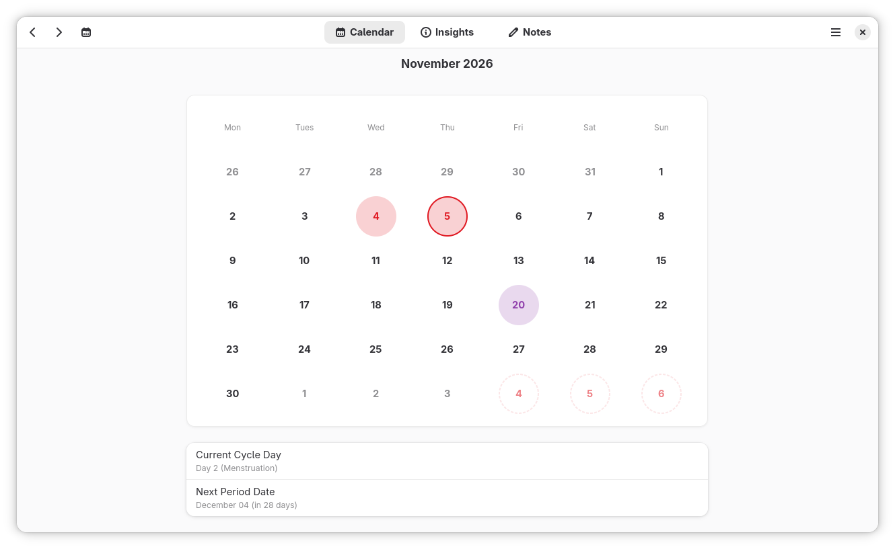
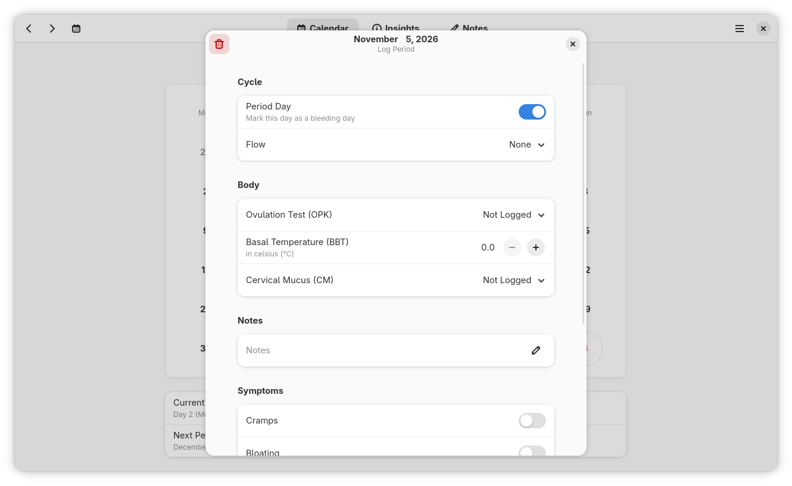
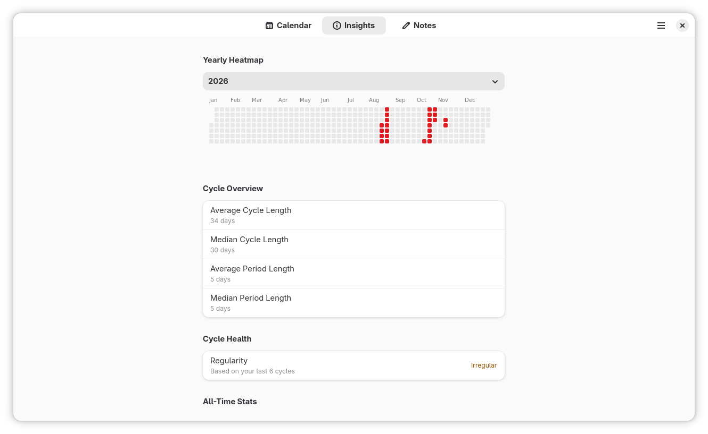

# bloom
**bloom** is a private and native cycle tracker for GNOME. It helps you understand your body's patterns by predicting upcoming periods and ovulation days without ever sending your data to the cloud or third-party services.

## features
- smart predictions: uses a rolling 6-cycle median to predict your next period and ovulation days, accounting for irregular cycles. (This can be changed in 'Preferences', if you already know your cycle length)
- comprehensive logging: track periods, flow intensity, basal body temperature (BBT), cervical mucus (CM), ovulation tests (OPK), physical symptoms, and daily notes.
- insights and stats: view your average/median cycle lengths, cycle regularity, and a yearly heatmap of your periods.
- searchable notes: instantly search through your daily notes and jump directly to that day on the calendar.
- data ownership:
    - export and import your data via CSV.
    - all data is stored locally in a secure SQLite database (0600 permissions).
    - no accounts, no clouds, no tracking.
- background reminders: sends you a notification 2 days, 1 day, and on the day your period is predicted to start.

## screenshots




## installation
### flatpak (recommended)
you can download the latest `.flatpak` bundle from the [Releases](https://github.com/oatbiscuit/bloom/releases/latest) page.

to install it via the terminal:

```bash
flatpak install --user bloom-<version>-<arch>.flatpak
```

You can also double click the `*.flatpak` and install via GNOME Software or KDE Discover, if you don't want to use the terminal.

### rpm (Fedora/RHEL)
you can find the latest rpm from the [Releases](https://github.com/oatbiscuit/bloom/releases/latest) page.

to install, use:

```bash
sudo dnf install ./bloom-<version>-1.<dist>.<arch>.rpm
```

### build from source
#### dependencies:
**Fedora**
```bash
sudo dnf install meson valac blueprint-compiler gettext \
  gtk4-devel libadwaita-devel sqlite-devel libgee-devel \
  glib2-devel desktop-file-utils appstream
```

**Ubuntu/Debian**
```bash
sudo apt install meson valac blueprint-compiler gettext \
  libgtk-4-dev libadwaita-1-dev libsqlite3-dev libgee-0.8-dev \
  libglib2.0-dev desktop-file-utils appstream
```

#### download
download and extract the `*-source.tar.xz` file from the [Releases](https://github.com/oatbiscuit/bloom/releases/latest) page.

#### build
inside the root folder, run:
```bash
meson setup build
meson compile -C build
```

#### install
```bash
sudo meson install -C build
```

#### uninstall
```bash
sudo ninja -C build uninstall
```

## medical disclaimer
bloom is a wellness tracker intended for personal awareness only. It is not a medical application and should not be used as a method of contraception or for medical diagnosis. The predictions provided are estimates based on historical data and should not replace professional medical advice.

## license
this project is licensed under the GPL-3.0-or-later License. see the [COPYING](https://raw.githubusercontent.com/oatbiscuit/bloom/refs/heads/main/COPYING) file for details.
